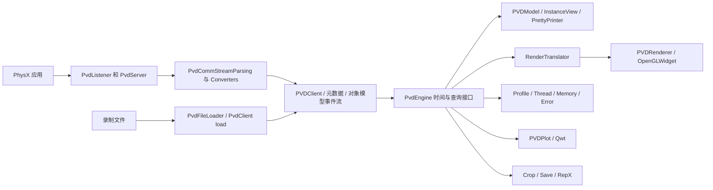

# PhysX Visual Debugger 3 逆向结果

2026-11-14 对用户指定安装目录进行静态分析。该版本是 Windows x64 原生 C++ / Qt Widgets 应用，带有丰富的 MAP、PDB、Qt 生成代码和嵌入资源。已建立适合独立重写的模块与功能基线，并恢复了 18 份实际 GLSL 资源源码。业务 C++ 的原始源码没有恢复。

## 目标身份

| 项目 | 结果 | 证据 |
| --- | --- | --- |
| 主程序 | PVD3.exe，2,150,464 字节，PE32+ / x86-64 | `analysis/binary/PVD3-llvm-readobj.txt`；REA 资源证据 |
| SHA256 | `2371e7123c9159677c13cc8b070047a763bdb01f96a0f09e313caa5177a679bb` | 同上 |
| 实现类型 | 原生 PE；COM Descriptor 为 0，无 CLI 元数据目录 | `analysis/binary/PVD3-dumpbin.txt` |
| 内部产品名 | PVDNext；OriginalFilename 为 PVDNext.exe | PE 版本资源；文件名 PVD3.exe 不代表另一套实现 |
| 版本线索 | About 生成文案为 3.18.2.16；EXE 版本资源为 0.0.0.0 | 安装目录 `.ui/ui_aboutdialog.h:125`；`analysis/binary/dll-version-resources.json` |
| 构建时间线索 | PE / MAP 时间戳指向 2021-01-22 | 时间戳不能独立证明发布日；About 的 2018 版权也不能替代构建日期 |
| UI 运行库 | Qt 5.10.0；Widgets、Gui、Core、OpenGL；Qwt | DLL 版本资源和导入表；生成头也标注 UIC 5.10.0 |
| 工具链线索 | PE linker 14.16；MSVC 运行库 | PE 头和导入表，不能据此恢复完整编译参数 |
| 调试符号 | PDB GUID `{19BD2701-E8A7-477F-B810-8AE21A01EBB0}`，Age 2，与 EXE RSDS 匹配 | `analysis/symbols/pdb-summary-modules.txt` 和 EXE DebugDirectory |

MAP 共提取 32,705 条符号记录，其中 10,540 条标记为代码；它们包含别名、模板实例及导入记录，不是唯一函数计数。索引见 `analysis/symbols/map-symbols.csv`。PDB 虽声明未剥离并保留类型，但本次未从其类型表确认恢复 PvdEngine 等核心领域类的字段布局，不能把符号签名当作完整结构体定义。

## 功能基线

以下行为来自安装包手册、当前 Qt 生成头及符号，不表示已经逐项运行验证。

| 功能 | 要保留的行为 | 来源 |
| --- | --- | --- |
| 采集与录制 | TCP 接收；SDK 直接写文件；加载、保存捕获 | 手册 p4–6；PvdListener、PvdFileLoader、PVDClient |
| 时间轴 | 首尾、逐帧、正放/倒放、跳帧、帧滑条 | 手册 p3、p7；PvdEngine seek 接口 |
| 对象检查 | Scene / Actor / Shape / Geometry / Joint / Material 等树；类型化属性、数组、引用跳转 | 手册 p3、p8；当前 UI 左侧树控件 |
| 3D 视图 | 自由/录制相机；选中、聚焦和跟踪；上轴、左右手系；状态着色 | 手册 p6、p9、p11；Camera、CameraController、PVDRenderer |
| 调试绘制 | contacts、joints、bounds、velocity、axes、scene queries、particles 等 | 手册 p9、p11；当前可视化设置和着色器 |
| 性能分析 | 时间事件视图、按线程分组、事件耗时曲线 | 手册 p9–10；ProfileEventLoader / Handler、两种 TreeWidget |
| 内存分析 | 分配与释放、来源文件/行号、逐帧和累计统计 | 手册 p9–10；Engine memory 查询接口 |
| 错误流 | Code / Message / Location | 手册 p10；当前 UI 表头 |
| 曲线 | 属性或耗时随帧变化；缩放；双击跳帧；CSV 导出 | 手册 p10；PVDPlot、Qwt 依赖 |
| 剪辑 | 按游标分割、裁左/右、片段另存 | 手册 p10；PvdEngine::crop；主窗口槽 |
| RepX 导出 | 当前状态的复现场景导出；当前 UI 区分 Selected / Visible / All | 手册 p7；当前 Action；PvdRepXExport |
| 搜索与设置 | 对象与 profile 搜索；颜色、抗锯齿、数值格式、大数组分组 | 当前 UI；`analysis/manual/manual-ui-findings.txt` |

UI 已提取 180 条文案到 `analysis/manual/ui-strings.json`，含源文件和行号。完整功能、快捷键和滑条边界见 `analysis/manual/manual-ui-findings.txt`。例如 Ctrl+F 对象查找、Ctrl+G 跳帧、Ctrl+Alt+Y 分割，均有生成头证据。

## 原程序模块边界

下图的模块和接口名称来自符号；箭头表示结合签名、手册和资源得到的数据流归纳，不是完整动态调用图。

几个具有直接设计意义的接口：

- `PvdEngine::getCurrentFrame(streamId)`、`getFrameCount(streamId)`、`getFrameInfo(frame, streamId)` 表明帧查询带流标识；新内核应保留多流/多场景时间语义。
- `getClasses`、`getProperties`、`getRawPropertyValue`、`getNbArrayElements` 表明属性检查由元数据驱动，不能只硬编码刚体的位置和旋转。
- `parseProfileEvents`、`parseMemoryEvents` 与 `seek` 分离，支持把专门事件通道做独立索引。
- `PvdObjectModelEventForwardMutatorImpl` 等正向/反向相关符号和 seek 汇编支持存在可回退事件模型；具体撤销记录布局仍未完整恢复。
- `PvdRandomAccessIOStream`、保存/裁剪和对象元数据序列化表明持久化层是独立子系统。

可复查入口为 `analysis/symbols/application-methods.txt`，每条保留 MAP 行号、模块、地址和解码后的签名。主要代码来源包括 PVDCore、PxPvdSDK、PxFoundation，另有 zlib 和 Breakpad 静态库符号；这些并非都以独立 DLL 交付。

## 已恢复的渲染源码

从 `.qrc/qrc_mainwindow.cpp` 的资源载荷恢复 18 份 GLSL 原文，输出位于 `analysis/manual/recovered-shaders/`。42 个总资源条目及原始载荷长度、SHA256、源行号见 `analysis/manual/resource-inventory.json`。恢复时逐个验证声明长度与实际字节数。

| 着色器组 | 源码可确认的内容 |
| --- | --- |
| simple | 实例变换和颜色；片元阶段用导数构造面法线 |
| hf / hf_pick | 高度场相关渲染与整数实例 ID 输出 |
| particle | 面向视点的 billboard 与粒子尺寸 |
| line / arrow / contact | 调试线、方向标记及接触点相关通道 |
| pick | 实例 ID 经整数颜色输出；结合命名可推断 GPU picking，但 CPU 回读路径尚未核对 |
| outline | 基于屏幕纹理邻域与深度的紫色轮廓；遮挡处降低透明度 |

其中 17 份声明 `#version 400 core`，`simple.frag` 为 `#version 400`。这说明这批资源以 GLSL 4.00 为目标，不能据此断言当前机器实际选择了何种 OpenGL 上下文或绘制了哪些 pass。

## 已解决的文档冲突

1. **默认端口：5425。** 手册 p4 正文写 5435，但两段 SDK 示例均写 5425。EXE 的主窗口构造函数在 `0x140023091` 装载 `0x1531`，随后于 `0x14002309D` 调用 `PvdListener::setPort(int)`，紧接启动监听。故该版本初始化为 5425；尚未实测监听地址或运行中改写。
2. **文件扩展名：不能只照手册。** 手册 p6 描述 `.pxd/.pxd2`；二进制打开对话框字符串出现 `*.pvd/*.pxd2`，保存对话框为 `*.pxd2`。同一扩展名可能涉及不同输入/保存路径，应按魔数区分实际格式，再通过样本确认 UI 各操作的输出。
3. **当前设置与手册不同。** 手册有 far plane slider，当前生成头未出现相同控件；当前 UI 则新增 Sleeping objects、Trigger shapes 等选项。
4. **版本标识来自不同年代。** 手册 changelog 到 2016，生成的 About 是 2018 文案，PE 构建时间线索为 2021。重写验收应优先当前程序与当前构建产物。

端口汇编证据见 `analysis/binary/port-initialization-excerpt.txt` 地址 `0x140023091` 附近。协议/容器差异另见 [兼容笔记](protocol-and-compatibility.md)。

## 覆盖范围和剩余问题

| 问题 | 状态 |
| --- | --- |
| 程序身份、运行库、模块接口 | 已有静态证据 |
| UI 功能与资源 | 已有当前生成代码及手册证据；18 份着色器原文恢复 |
| 关键流魔数和监听默认端口 | 已有汇编证据 |
| 完整网络事件编码、旧 SDK 协议分支 | 部分确定；官方 3.4 源码可参考，旧转换器需继续核对 |
| 保存文件完整布局、索引、撤销语义 | 部分确定；还不能实现可靠兼容读写 |
| 实际加载、帧回退、拖拽物体、相机与导出 | 未完成运行验证 |
| 大场景内存和帧率 | 未测，不能据此承诺新架构性能 |

当前没有可用的原生反编译引擎绑定。REA doctor 报告 Codex 未注册 REA、Ghidra/Hopper/IDA/Kuna 未配置；本轮使用已缓存 REA 的无引擎 PE 资源分析，以及 LLVM/MSVC 工具作静态检查。没有修改 MCP 配置或安装反编译引擎。电脑观察工具启动时返回 `trusted Node process exited unexpectedly`，所以没有运行截图或交互证据。

REA 原始资源记录为 `analysis/rea/pvd3-pe-resources.json`，Evidence ID 为 `ev_6c689c511382a3ec61823efeb7d6f3b0acba40044aab3098a6b7ae5997739f73`。它只证明 PE 资源目录、范围、哈希和静态图标关系；其余 LLVM、MAP、PDF、资源恢复结论均是普通工具证据，不借用该 Evidence ID 表示已反编译或已运行。

## 证据文件导航

- `analysis/binary/file-manifest.json`：安装文件身份与哈希。
- `analysis/binary/PVD3-dumpbin.txt`、`PVD3-llvm-readobj.txt`：PE 与导入导出。
- `analysis/binary/PVD3-selected-strings.json`：有偏移的功能、格式与协议字符串线索。
- `analysis/symbols/map-summary.json`、`map-symbols.csv`：符号索引与模块计数。
- `analysis/symbols/pdb-summary-modules.txt`、`pdb-types.txt`：PDB 原始提取。
- `analysis/symbols/*disassembly.txt`：流识别、加载、seek 等局部汇编。
- `analysis/manual/manual-text.txt`：全部 12 页手册提取；page 图片用于复核版面。
- `analysis/manual/manual-ui-findings.txt`：功能、设置、快捷键和资源取证。
- `analysis/official-sdk/manifest.json`：官方 SDK 固定提交、来源 URL 和各文件哈希。
