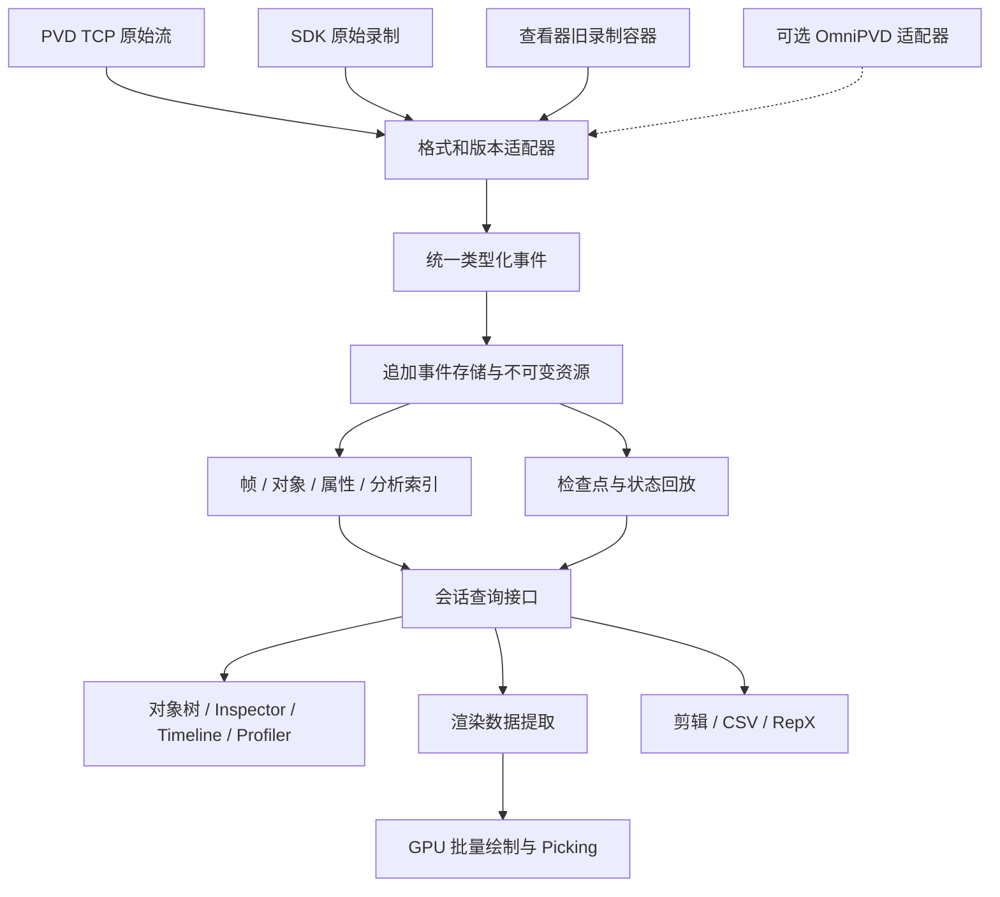

# PVD 现代化重写方案

当前实现已按用户选择采用独立 C++17 内核，构建目标为 `pvd::core`。下文的 UI 比较仍可用于后续前端选型，内核不绑定其中任何一套；构建与实际兼容范围见 [内核说明](kernel.md)。

建议先实现独立的数据与回放内核，再建设现代界面。第一个可验收成果应是“打开真实捕获，准确显示任一帧的对象树、属性与 3D 状态”。只有界面原型无法验证协议兼容、历史状态和大场景处理这些核心要求。

本方案是根据逆向结果提出的新设计，不代表原程序的内部实现。

## 核心架构

适配器输出公共领域事件；UI 不接触旧协议字段和原程序对象布局。文件读入和实时接入共享事件归一化，使同一 capture 的离线和在线分析有一致语义。旧录制读取、原始流读取和 OVD 各自有版本探测，不能混在一个依赖后缀的 loader 中。

建议最小领域模型：

- `Session`：来源、SDK/协议版本、采集通道、错误/截断状态、各 stream。
- `Schema`：字符串表、类及继承、属性类型/数组/枚举、批量消息描述。
- `ObjectKey`：会话、流和原始对象 ID；分配地址被复用时再用生命周期序号区分。
- `Event`：带时间/序号的创建、销毁、属性、数组、引用和专用通道事件。
- `FrameIndex`：scene/stream 内的帧与事件区间；保留时间戳及换算比例。
- `StateAtFrame`：从检查点恢复后重放到目标帧，供全部视图共享。
- `BlobStore`：网格、高度场、大数组等不可变载荷，避免每一帧复制整份几何。

对象 ID 与时间戳保留 64 位精度；如果前端使用 JavaScript，跨边界采用字符串、BigInt 或明确的二进制编码，避免隐式转成 Number。原始 ID 是数据身份，不是可在新进程中解引用的指针。

## 回放和性能约束

采用事件日志加周期检查点实现随机 seek。倒放可先通过“恢复较早检查点并重放”完成；是否再实现逆事件取决于真实录制的延迟与空间测量。检查点间距应按事件量、状态大小和目标 seek 延迟调整，不能仅按固定帧数猜测。

几何上传与逐帧姿态更新分开，GPU 使用实例批次和稳定 picking ID。先复现原版的轴向、左右手系、胶囊方向、平面和高度场规则，再升级视觉表现。恢复的 GLSL 可以作为行为参考；WebGPU 路线需要对应 WGSL 实现和图像/选取结果对照。

大对象树、数组、内存事件和时间线需要虚拟化、分页与区间查询。UI 只请求当前可见数据；前后端传输应批量化，不能每帧为每个对象调用一次 IPC，也不能反复把完整场景 JSON 化。前端每次 seek 带请求代次，取消或丢弃过时查询结果。

接收线程、解析任务、持久化和视图刷新使用有界队列。实时压力过大时可以降低 UI 刷新频率，但录制事件的丢失必须明确报告。设置中展示“通道未采集”“通道有数据但当前无事件”和“解析不支持”的区别。

## 技术路线选择

内核已固定采用 **C++17**。如果后续选择 Web 技术界面，可在现有库之上增加 C ABI / IPC 桥接，再配 TypeScript 前端和 GPU canvas；这属于前端集成工作，不需要重写数据内核。Tauri 等宿主可以作为前端选项，具体桥接与 GPU 支持须另行验证。[Tauri 官方架构入口](https://v2.tauri.app/start/)

如果优先原生 GPU 控制和 C++ 图形工具链，则选 **独立 C++ 内核 + Qt 6 / Qt Quick + 自定义 GPU 视图**。Qt Quick 的 RHI 可覆盖多种图形 API；这提供现代 UI 与原生渲染路径，但旧 Qt5 Widgets 源码不会因升级版本而自动获得新交互设计。[Qt 图形架构](https://doc.qt.io/qt-6/topics-graphics.html)

| 取舍 | Tauri 与 Web 前端 | Qt Quick 与原生视图 |
| --- | --- | --- |
| 对象检查、搜索、曲线界面 | 适合利用 Web 组件体系 | 需要选择和实现合适的 QML/原生控件 |
| 数据内核 | 现有 C++ 库，通过后续桥接调用 | 直接链接现有 C++ 库 |
| 大场景绘制 | 验证 WebView GPU 支持、传输和拾取延迟 | 验证原生渲染与 QML 集成、线程与资源生命周期 |
| 重写风险 | Web/native 数据桥接与平台差异 | UI 重新设计、图形抽象和控件开发成本 |
| 选型依据 | 代表性录制上的加载、seek、内存、交互测量 | 相同数据集和相同指标 |

这两条路线都能实现新架构。现阶段尚无场景规模和目标硬件数据，先用一个代表性录制做垂直切片，按结果确定渲染栈；不把框架宣传中的性能作为本项目结论。

## 功能里程碑和验收

| 阶段 | 交付物 | 完成条件 |
| --- | --- | --- |
| 0 兼容样本 | 原始流、原版另存文件及期待状态 | 明确协议版本、场景、帧、对象与采集通道；文件有哈希 |
| 1 无界面内核 | 识别、元数据、对象事件、帧索引、seek | 任意目标帧的对象/属性与原版核对一致；损坏输入有定位信息 |
| 2 查看闭环 | 时间轴、树、Inspector、3D、选择联动 | 同一选择在全部面板一致；顺播/随机跳帧/倒放得到相同状态 |
| 3 实时采集 | TCP、连接状态、持久化、异常断开 | 原 SDK 接入；断开后文件可重新打开；积压与丢失可见 |
| 4 工程分析 | Profile、Thread、Memory、Error、曲线CSV | 已知事件时长、分配释放和导出数值与样本一致 |
| 5 旧工程兼容 | 历史容器、裁剪、RepX、旧协议 | 裁剪保留起始对象状态；RepX 可在对应 SDK 重新载入 |
| 6 体验扩展 | 多会话、帧间差异、书签、布局管理 | 每项有使用场景与回归样本，不能破坏基础回放一致性 |

第一版优先刚体、基础几何和属性检查；cloth/APEX/particles、所有旧 SDK 分支与完整 RepX 可以分批纳入兼容矩阵。当前程序中的搜索、剪辑、曲线、错误和复现场景导出应在清单中保留，避免 3D 视图完成后遗漏分析工具的工作流。

建议持续测量加载耗时、峰值内存、随机 seek 的 p50/p95、UI 输入延迟、可见实例数量和实时接收吞吐。具体门槛在拿到真实工作负载后确定。

## 最值得继续深入的三处

1. `PvdCommStreamEventReader` 与版本转换器：确定旧协议、字节序及分块属性的实际支持边界。
2. `Client::load/save` 与 `PvdObjectModelEventStream`：完成容器、元数据、页索引和回退语义，产出最小兼容读取器。
3. `RenderTranslator` 与 `PVDRenderer`：从已恢复 shader 反向确定 CPU 侧 buffer 布局、几何生成与 picking/readback 行为。

这三条路径分别解决“能读数据”“能准确回放”“能正确看到并选中对象”，也构成后续重写的技术主线。
